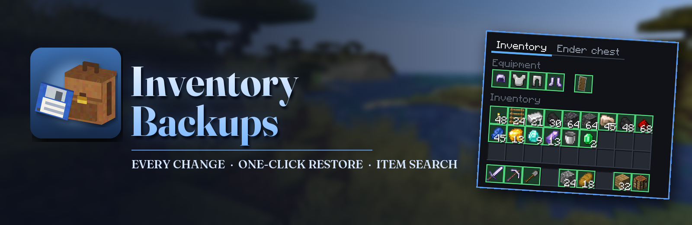
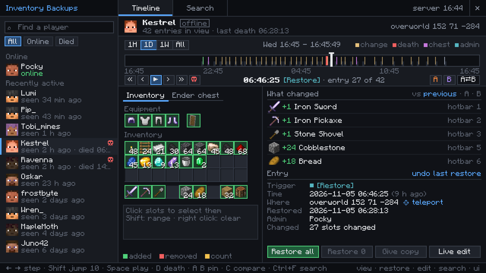
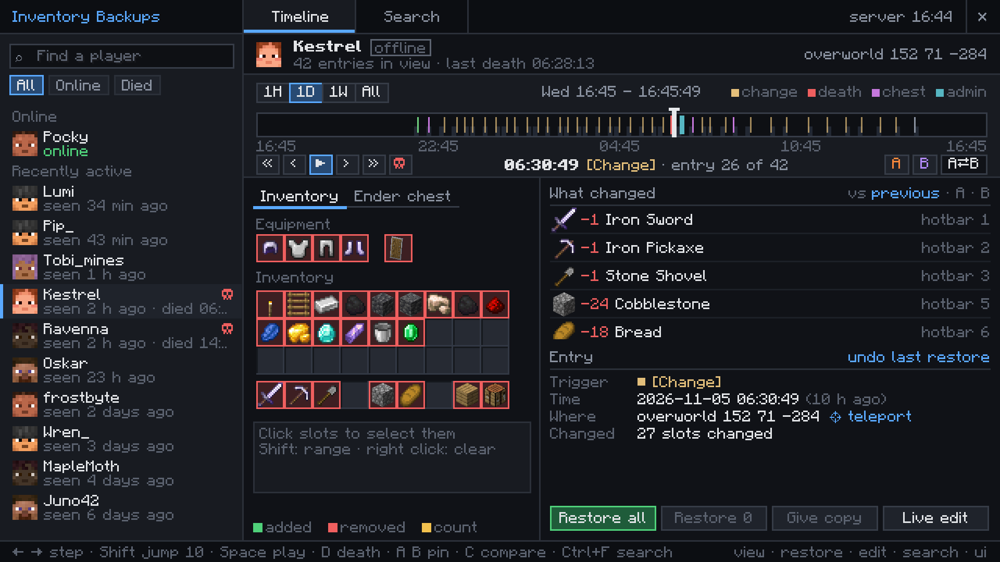
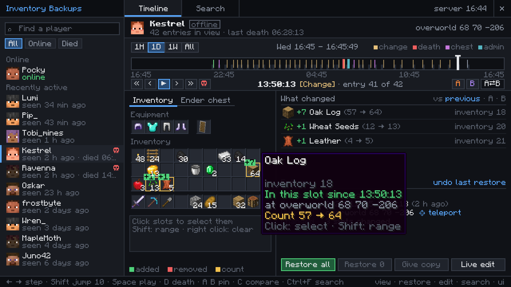
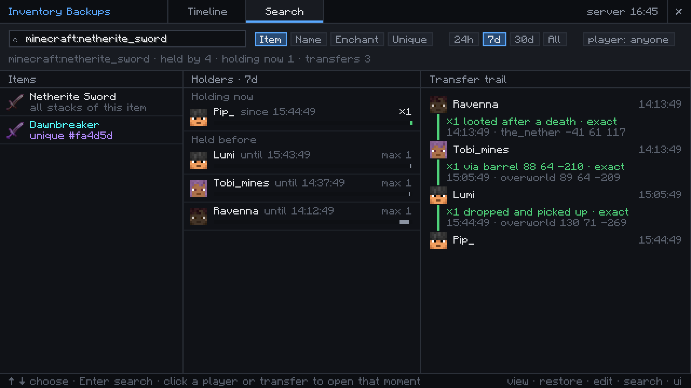
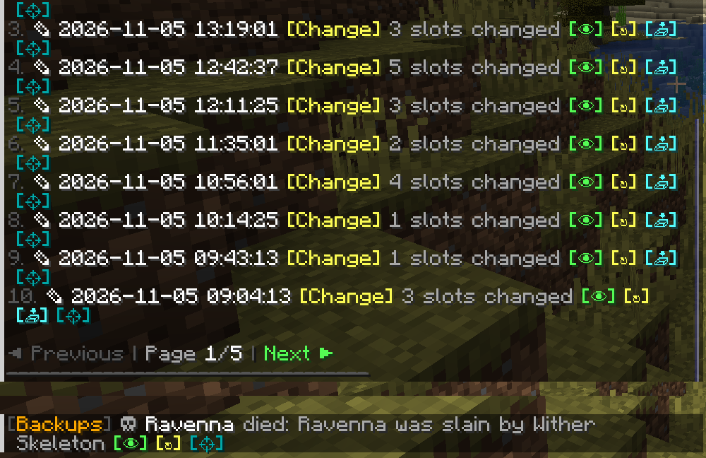
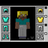
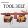

<!-- CurseForge description of Inventory Backups. HTML: paste it in the editor's HTML (source) mode, not Markdown mode.
     The "more-mods" block is generated by tools/mod-catalog/sync_mod_links.py - never edit it by hand. -->

   

<em>Inventory backups for server admins.</em>

<strong>The mod records every change in every player's inventory, armor, ender chest and mod slots. When someone loses their things to a creeper, a lava pool or a thief, open their timeline, pick the moment before it happened and give everything back with one click.</strong>

<strong>About 100 bytes</strong> per change &nbsp;&middot;&nbsp; <strong>Offline players</strong> too &nbsp;&middot;&nbsp; <strong>Vanilla clients</strong> work through chat

<h2 style="text-align:center">After a death</h2>

<em>Kestrel was blown up by a creeper deep in a mine and came back with nothing. The death entry still holds every slot, with the cause and the place. Restore all puts it back, or pick only some slots. An admin who restored the wrong moment can undo it.</em>

<h2 style="text-align:center">Every change on the timeline</h2>

<em>Pickups, crafting and chest visits become entries, one for each burst of changes. Hover a slot to see when the item got there and where the player stood. Pin two moments as A and B to compare them, or play the whole day back.</em>

<h2 style="text-align:center">Where did the sword go?</h2>

<em>Search for any item by id, name or enchantment and see who has it now and who had it before. One named or enchanted stack can be followed from player to player: dropped at a death, picked up, put into a barrel, taken out.</em>

<h2 style="text-align:center">From chat, without the client mod</h2>

<em>Admins with a vanilla client get clickable lists in chat with view, restore, copy and teleport buttons on every entry. With <code>deathAlerts</code> on, online admins get a message about every death with items and can restore it from there.</em>

<h3 style="text-align:center">Getting started</h3>

Put the mod into the mods folder of the server. On <a href="https://fabricmc.net">Fabric</a> it also needs <a href="https://www.curseforge.com/minecraft/mc-mods/fabric-api">Fabric API</a> and <a href="https://www.curseforge.com/minecraft/mc-mods/forge-config-api-port">Forge Config API Port</a>. Admins who want the timeline screen put the same file into their own mods folder and press <code>Ctrl+I</code>. Other players do not need it. Operators can use everything. With <a href="https://luckperms.net">LuckPerms</a>, grant <code>inventorybackups.view</code>, <code>.restore</code>, <code>.edit</code>, <code>.search</code> and <code>.ui</code> per group. <code>/inventory list &lt;player&gt;</code> shows the timeline in chat and <code>/invsearch &lt;item&gt;</code> finds items. Backups and configs of version 2.x are taken over on the first start.

<strong>Works with</strong>

      

<!-- more-mods:start icons -->

<b>More mods by Pocky</b>

<!-- more-mods:end -->

Made by <strong>Pocky</strong>. The earlier Minecraft 1.20.1 Forge and Fabric versions (2.0) were made by DjJewl. Special thanks to PiglinMine.com. Source on <a href="https://github.com/Pocky-l/inventory-backups">GitHub</a> (MIT).

