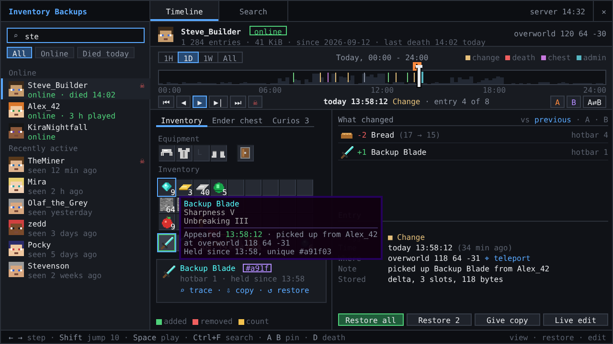

<p align="center">
  
</p>

<h1 align="center">Inventory Backups</h1>

<p align="center">
  <b>Every inventory change of every player, recorded</b> - roll back any moment with one click, find any item and see who took it, online or offline.
</p>

<p align="center">
  <a href="https://www.curseforge.com/minecraft/mc-mods/inventory-backups"></a>
  <a href="https://www.minecraft.net"></a>
  <a href="https://neoforged.net"></a>
  
  <a href="LICENSE"></a>
</p>

<p align="center">
  
</p>

## Features

- 📼 **Every change recorded** - inventory, armor, offhand, ender chest and mod slots, merged into one entry per
  burst; about 100 bytes per change and 0.005 ms per player and tick.
- 🕒 **A timeline with context** - deaths with cause and place (recorded before the items drop), joins, quits,
  chests used, restores and edits by admins.
- ↩️ **Restore in one click** - a whole moment or only some slots, with undo; or give yourself a copy and leave the
  player's items alone.
- 🔍 **Find any item** - who has it now, who had it and when, by id, name, enchantment or one exact stack, with its
  trail through drops, death loot and chests; `/invsearch container` shows who emptied a chest.
- 🖥️ **Admin screen** - scrub the timeline, play it back, compare two moments, see what changed and where every item
  came from (`Ctrl+I`, needs the mod on the admin's client).
- 💤 **Offline players too** - restore and edit players who are not online; the change goes into their save file.
  Commands suggest their names too.
- 🎒 **Mod slots** - Curios, Accessories, Cosmetic Armor, Traveler's Backpack, Tool Belt and Backpacked are backed up
  and restored with the rest.
- 🗜️ **Small and safe storage** - compact day files written in the background, thinned with age instead of cut off,
  with disk budgets; a crash loses seconds at most.
- 🔐 **Permissions** - separate view, restore, edit and search nodes for LuckPerms; operators without one. Works for
  vanilla clients through clickable chat.

## Controls

| Key | Action |
|---|---|
| `Ctrl+I` (configurable) | Open the admin screen |
| `←` `→` / `Shift` | Previous / next entry, 10 at a time |
| `Home` `End` | First / newest entry |
| `Space` | Play the timeline |
| `D` | Jump to the previous death |
| `A` `B` | Pin the entry as A or B; `C` compares with previous, A or B |
| `Ctrl+F` | Item search |
| `Ctrl+A` | Select all shown slots |

## Commands

Each command needs its permission node (default: operator level 2). `/enderchest` has the same sub-commands as
`/inventory` and works on the ender chest part of the timeline.

| Command | What it does |
|---|---|
| `/inventory list <player> [filter] [page]` | Clickable timeline; filters: `2025-03`, `2025-03-15`, `death`, `restore`, `container`, ... |
| `/inventory view <player> <time>` | Read-only preview of a state |
| `/inventory set <player> <time>` | Restore a state (the previous one stays recorded) |
| `/inventory undo <player>` | Undo the last restore |
| `/inventory copy <player> <time>` | Copy the items of a state into your inventory |
| `/inventory player <player>` | Edit the live inventory, recorded as one edit |
| `/inventory snapshot <player>` | Record the current state now |
| `/inventory stats` | Main-thread cost, bytes per change, entries written |
| `/inventory ui` | Open the admin screen (client mod) |
| `/invsearch <item> [player\|*] [since]` | Holders and transfers of an item, `since` like `2h`, `3d` |
| `/invsearch name <text>` / `ench <id>` / `trace <fingerprint>` | Search by custom name, enchantment or one stack |
| `/invsearch at <time> <item>` | Who held the item at that time |
| `/invsearch container <pos> [since]` | Who put items into a container and who took them out |

`<time>` is what the chat buttons fill in, `latest`, or a `yyyy-MM-dd-HH-mm-ss` timestamp (2.x backup names work).

## Configuration

`config/inventory/InventoryBackups.toml` (also in game: Mods -> Inventory Backups -> Config). The 2.x keys stay valid.

| Option | Default | Meaning |
|---|---|---|
| `general.tickSaveEnabled` | `true` | Record inventory changes |
| `general.deadSaveEnabled` / `joinSaveEnabled` / `quitSaveEnabled` | `true` | Record deaths, mark joins and quits |
| `general.retentionDays` | `30` | Days to keep one state per day |
| `enderchest.enderChestEnabled` | `true` | Back up ender chests, `/enderchest` |
| `enderchest.enderChestTickSaveEnabled` | `true` | Record ender chest changes |
| `capture.settleSeconds` / `maxDelaySeconds` | `2.5` / `30` | Merge bursts of changes |
| `capture.scanSeconds` | `5` | Full slot comparison for changes no event reports |
| `capture.containerSessions` | `true` | Record puts and takes at containers |
| `storage.directory` | empty | Empty: `<world>/inventorybackups`; otherwise a path relative to the server folder |
| `storage.keyframeInterval` | `64` | Entries between full states |
| `retention.keepAllHours` / `hourlyDays` / `importantDays` | `24` / `7` / `90` | Thinning by age |
| `retention.playerBudgetMb` / `totalBudgetMb` | `64` / `4096` | Disk budgets, 0 = no limit |
| `migration.legacyBackups` | `ARCHIVE` | 2.x JSON backups after import: `KEEP`, `ARCHIVE`, `DELETE` |
| `permissions.permissionLevel` | `2` | Operator level when no permission mod decides |
| `search.probableLinkSeconds` / `probableLinkDistance` | `15` / `24` | Window for probable transfers |
| `search.maxResults` | `500` | Limit per search or request |

`preservationPeriod` and the ender chest death/join/quit/open options are deprecated and ignored. The client config
(`inventorybackups-client.toml`) sets playback speed, default zoom, 24 hour clock, highlighting and tooltip history.

## Installation

1. Install [NeoForge](https://neoforged.net) 21.1 for Minecraft 1.21.1 on the server and put the mod into `mods`.
2. Optional: admins who want the timeline screen put the same jar into their client's `mods` folder. Other players
   do not need it.

## Compatibility

[](https://www.curseforge.com/minecraft/mc-mods/curios) ✅ **[Curios API](https://www.curseforge.com/minecraft/mc-mods/curios)** (optional) - every curio slot, cosmetic slots included, is recorded, shown on the Mod slots tab, restored with the inventory and editable live.

[](https://www.curseforge.com/minecraft/mc-mods/accessories) ✅ **[Accessories](https://www.curseforge.com/minecraft/mc-mods/accessories)** (optional) - accessory and cosmetic slots are recorded and restored the same way; with the Curios compatibility layer each slot is recorded once.

[](https://www.curseforge.com/minecraft/mc-mods/cosmetic-armor-reworked) ✅ **[Cosmetic Armor Reworked](https://www.curseforge.com/minecraft/mc-mods/cosmetic-armor-reworked)** (optional) - the cosmetic armor slots are recorded and restored.

[](https://www.curseforge.com/minecraft/mc-mods/travelers-backpack) ✅ **[Traveler's Backpack](https://www.curseforge.com/minecraft/mc-mods/travelers-backpack)** (optional) - the worn backpack and everything in it is recorded and restored, also when it is placed on the ground at death.

[](https://www.curseforge.com/minecraft/mc-mods/tool-belt) ✅ **[Tool Belt](https://www.curseforge.com/minecraft/mc-mods/tool-belt)** (optional) - the belt slot and the tools on the belt are recorded and restored.

[](https://www.curseforge.com/minecraft/mc-mods/backpacked) ✅ **[Backpacked](https://www.curseforge.com/minecraft/mc-mods/backpacked)** (optional) - the equipped backpacks and their contents are recorded and restored.

[](https://luckperms.net) ✅ **[LuckPerms](https://luckperms.net)** (optional) - grant `inventorybackups.view`, `.restore`, `.edit`, `.search` and `.ui` per group instead of operator status.

## Building

```sh
./gradlew build
```

The jar is written to `build/libs/`. `./gradlew runGameTestServer` runs the game tests. The design of the admin
screen is in `docs/ui-mockup` (open `index.html` in a browser).

## Credits

- Author: **Pocky**.
- DjJewl - the Minecraft 1.20.1 Forge and Fabric versions.
- Special thanks to PiglinMine.com.

<!-- more-mods:start -->
## More mods by Pocky

**🌦️ Weather & nature**

<table>
  <tr>
    <td width="56"><a href="https://www.curseforge.com/minecraft/mc-mods/hoarfrost-snow-blizzards"></a></td>
    <td><a href="https://www.curseforge.com/minecraft/mc-mods/hoarfrost-snow-blizzards"><b>Hoarfrost: Snow & Blizzards</b></a> - seven kinds of snowfall, a living wind and soft snow on the land (<a href="https://github.com/Pocky-l/hoarfrost">source</a>)</td>
  </tr>
  <tr>
    <td width="56"><a href="https://www.curseforge.com/minecraft/mc-mods/petrichor-rain-storms"></a></td>
    <td><a href="https://www.curseforge.com/minecraft/mc-mods/petrichor-rain-storms"><b>Petrichor: Rain & Storms</b></a> - realistic rain, puddles, drips and branching lightning (<a href="https://github.com/Pocky-l/petrichor">source</a>)</td>
  </tr>
  <tr>
    <td width="56"><a href="https://www.curseforge.com/minecraft/mc-mods/rustling-leaves"></a></td>
    <td><a href="https://www.curseforge.com/minecraft/mc-mods/rustling-leaves"><b>Rustling Leaves</b></a> - falling leaves and leaf piles you can wade through, rake and blow away (<a href="https://github.com/Pocky-l/rustling-leaves">source</a>)</td>
  </tr>
</table>

**💡 Light**

<table>
  <tr>
    <td width="56"><a href="https://www.curseforge.com/minecraft/mc-mods/lumen-rigs"></a></td>
    <td><a href="https://www.curseforge.com/minecraft/mc-mods/lumen-rigs"><b>Lumen Rigs</b></a> - aimable spotlights and floodlights with colored light and visible beams (<a href="https://github.com/Pocky-l/lumen-rigs">source</a>)</td>
  </tr>
  <tr>
    <td width="56"><a href="https://www.curseforge.com/minecraft/mc-mods/neon-glowsticks"></a></td>
    <td><a href="https://www.curseforge.com/minecraft/mc-mods/neon-glowsticks"><b>Neon Glowsticks</b></a> - throwable glowsticks that bounce, roll and light up the dark (<a href="https://github.com/Pocky-l/neon-glowsticks">source</a>)</td>
  </tr>
</table>

**🎨 Graphics & performance**

<table>
  <tr>
    <td width="56"><a href="https://www.curseforge.com/minecraft/mc-mods/turbo-for-distant-horizons"></a></td>
    <td><a href="https://www.curseforge.com/minecraft/mc-mods/turbo-for-distant-horizons"><b>Turbo for Distant Horizons</b></a> - Distant Horizons terrain generated many times faster (<a href="https://github.com/Pocky-l/dhturbo">source</a>)</td>
  </tr>
  <tr>
    <td width="56"><a href="https://www.curseforge.com/minecraft/mc-mods/pocky-shaders"></a></td>
    <td><a href="https://www.curseforge.com/minecraft/mc-mods/pocky-shaders"><b>Pocky Shaders</b></a> - a cosy, natural shader pack that sets itself up (<a href="https://github.com/Pocky-l/pocky-shaders">source</a>)</td>
  </tr>
</table>

**⚔️ Gear & gameplay**

<table>
  <tr>
    <td width="56"><a href="https://www.curseforge.com/minecraft/mc-mods/holy-staff"></a></td>
    <td><a href="https://www.curseforge.com/minecraft/mc-mods/holy-staff"><b>Holy Staff</b></a> - a healing staff with three skills and flying heal numbers (<a href="https://github.com/Pocky-l/holy-staff">source</a>)</td>
  </tr>
  <tr>
    <td width="56"><a href="https://www.curseforge.com/minecraft/mc-mods/ranchers-vacpack"></a></td>
    <td><a href="https://www.curseforge.com/minecraft/mc-mods/ranchers-vacpack"><b>Rancher's Vacpack</b></a> - a Slime Rancher vacuum gun for items and small mobs (<a href="https://github.com/Pocky-l/ranchers-vacpack">source</a>)</td>
  </tr>
</table>

**⚡ Tech & energy**

<table>
  <tr>
    <td width="56"><a href="https://www.curseforge.com/minecraft/mc-mods/mekanism-advancedgenerators"></a></td>
    <td><a href="https://www.curseforge.com/minecraft/mc-mods/mekanism-advancedgenerators"><b>Mekanism Advanced Generators</b></a> - nine tiers of solar panels, big solar generators, cubes and cables for Mekanism (<a href="https://github.com/Pocky-l/Mekanism-MoreSolarPanels">source</a>)</td>
  </tr>
</table>

<!-- more-mods:end -->

## License

[MIT](LICENSE)
