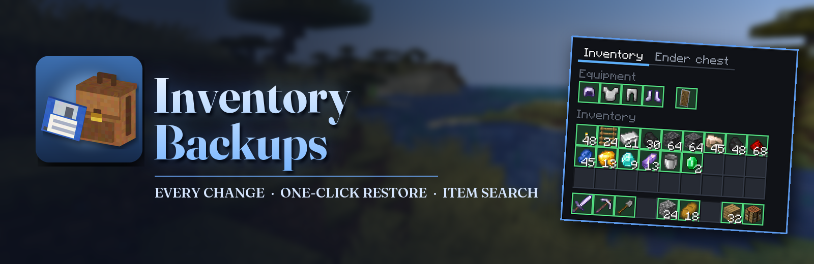
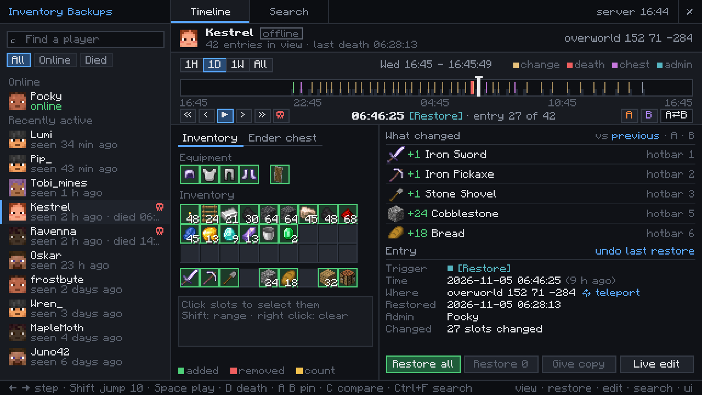
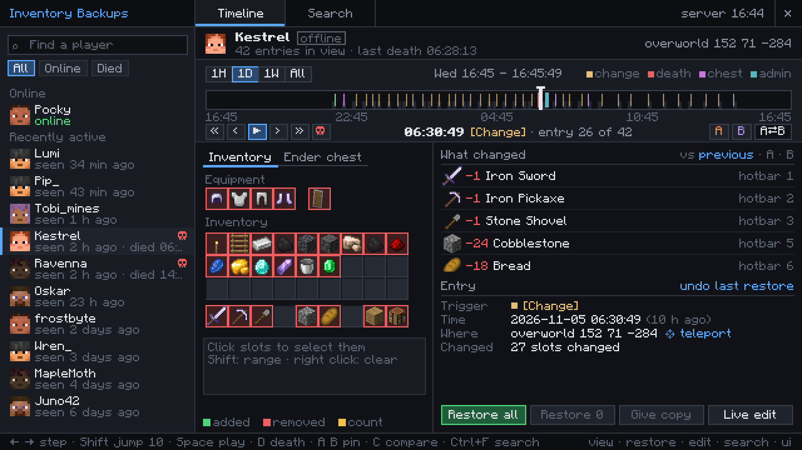
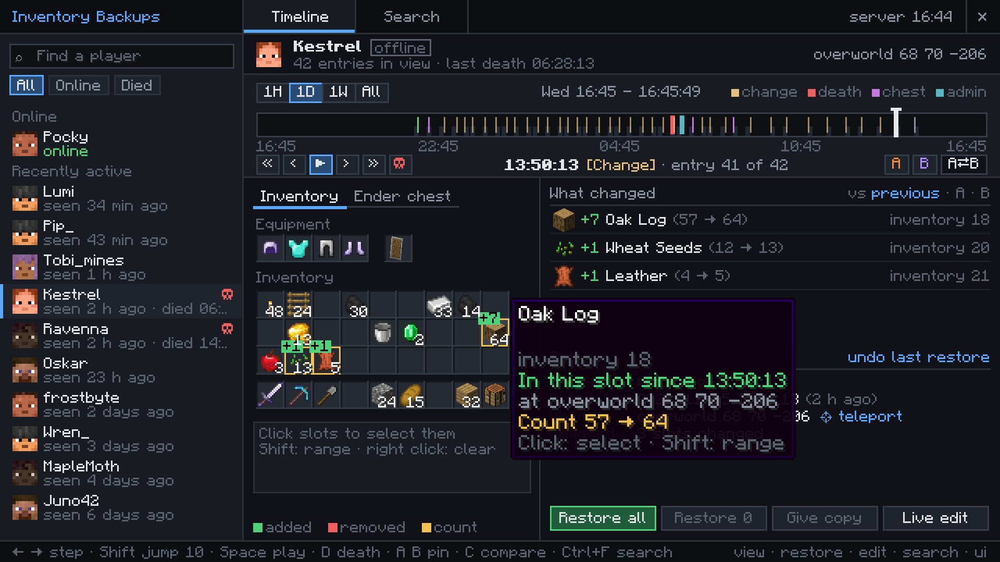
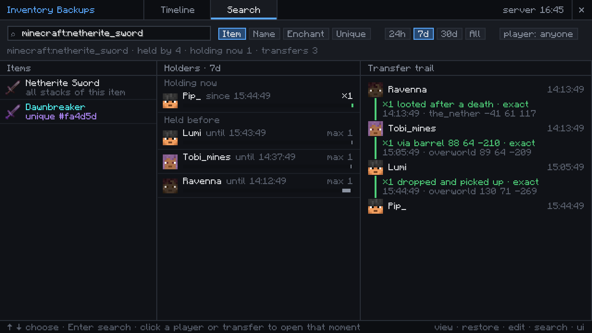
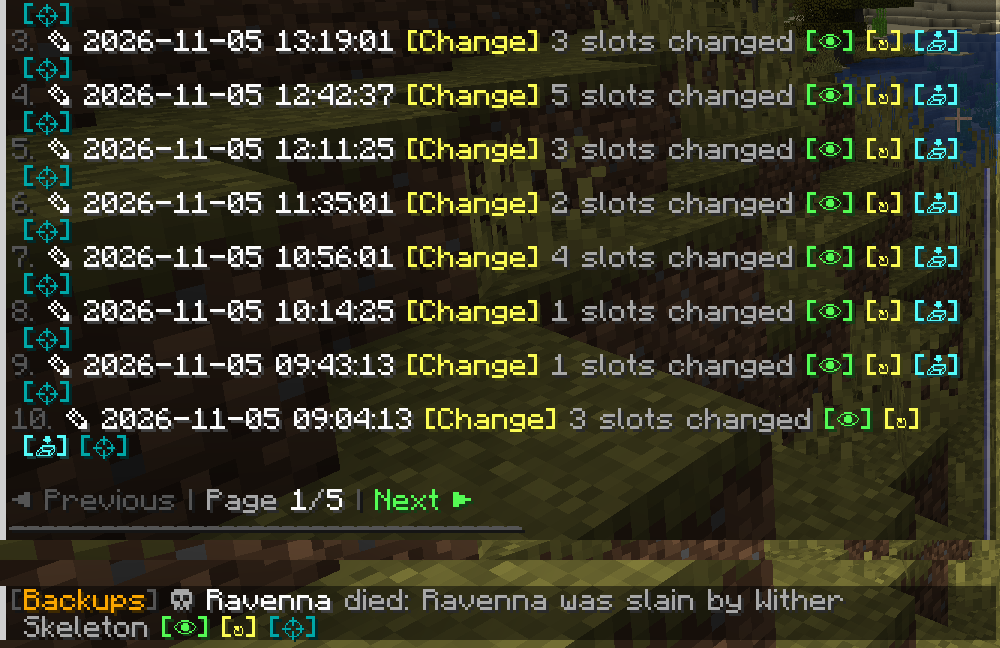
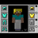
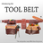

<p align="center">
  
</p>

<p align="center">
  <a href="https://www.curseforge.com/minecraft/mc-mods/inventory-backups"></a>
  <a href="https://www.curseforge.com/minecraft/mc-mods/inventory-backups/files"></a>
  <a href="https://neoforged.net"></a>
  
  <a href="LICENSE"></a>
</p>

<p align="center"><i>Inventory backups for server admins.</i></p>

<p align="center"><b>The mod records every change in every player's inventory, armor, ender chest and mod slots. When someone loses their things to a server bug, a crash, a bad connection or anything like it, open their timeline, pick the moment before it happened and give everything back with one click.</b></p>

<p align="center"></p>

<p align="center"><b>About 100 bytes</b> per change &middot; <b>Offline players</b> too &middot; <b>Vanilla clients</b> work through chat</p>

<h2 align="center">Main command: <code>/inventory ui</code></h2>
<p align="center">Opens the admin screen; <code>Ctrl+I</code> does the same. The admin needs the mod on their client too.</p>

## Features

<h3 align="center">After a death</h3>
<p align="center"></p>
<p align="center"><i>Kestrel was blown up by a creeper deep in a mine and came back with nothing. The death entry still holds every slot, with the cause and the place.<br>Restore all puts it back, or pick only some slots. An admin who restored the wrong moment can undo it.</i></p>

<h3 align="center">Every change on the timeline</h3>
<p align="center"></p>
<p align="center"><i>Pickups, crafting and chest visits become entries, one for each burst of changes. Hover a slot to see when the item got there and where the player stood.<br>Pin two moments as A and B to compare them, or play the whole day back.</i></p>

<h3 align="center">Where did the sword go?</h3>
<p align="center"></p>
<p align="center"><i>Search for any item by id, name or enchantment and see who has it now and who had it before.<br>One named or enchanted stack can be followed from player to player: dropped at a death, picked up, put into a barrel, taken out.</i></p>

<h3 align="center">From chat, without the client mod</h3>
<p align="center"></p>
<p align="center"><i>Admins with a vanilla client get clickable lists in chat with view, restore, copy and teleport buttons on every entry.<br>With <code>deathAlerts</code> on, online admins get a message about every death with items and can restore it from there.</i></p>

More in detail:

- Inventory, armor, offhand, ender chest and the slots of other mods are recorded, merged into one entry per burst of
  changes: about 100 bytes per change and 0.005 ms per player and tick. Deaths are recorded before the items drop,
  even when a grave or backpack mod moves them away first.
- The timeline marks deaths with cause and place, joins, quits, chests used, restores and edits by admins.
- Restore a whole moment or only the selected slots, undo the last restore, or give yourself a copy and leave the
  player's items alone. Live edit opens the player's real inventory.
- Players who are offline can be restored and edited too: the change goes into their save file. Commands suggest
  their names.
- Storage is a set of compact day files written in the background, thinned with age instead of cut off, with disk
  budgets per player and in total. A crash loses a few seconds at most.
- Separate permission nodes for viewing, restoring, editing and searching; operators without a permission mod.

## Controls

| Key | Action |
|---|---|
| `Ctrl+I` (configurable) | Open the admin screen |
| `←` `→` / `Shift` | Previous / next entry, 10 at a time |
| `Home` `End` | First / newest entry |
| `Space` | Play the timeline |
| `D` | Jump to the previous death |
| `A` `B` | Pin the entry as A or B; `C` compares with previous, A or B |
| `Ctrl+F` | Item search |
| `Ctrl+A` | Select all shown slots |

## Commands

Each command needs its permission node (default: operator level 2). `/enderchest` has the same sub-commands as
`/inventory` and works on the ender chest part of the timeline.

| Command | What it does |
|---|---|
| `/inventory list <player> [filter] [page]` | Clickable timeline; filters: `2025-03`, `2025-03-15`, `death`, `restore`, `container`, ... |
| `/inventory view <player> <time>` | Read-only preview of a state |
| `/inventory set <player> <time>` | Restore a state (the previous one stays recorded) |
| `/inventory undo <player>` | Undo the last restore |
| `/inventory copy <player> <time>` | Copy the items of a state into your inventory |
| `/inventory player <player>` | Edit the live inventory, recorded as one edit |
| `/inventory snapshot <player>` | Record the current state now |
| `/inventory stats` | Main-thread cost, bytes per change, entries written |
| `/inventory ui` | Open the admin screen (client mod) |
| `/invsearch <item> [player\|*] [since]` | Holders and transfers of an item, `since` like `2h`, `3d` |
| `/invsearch name <text>` / `ench <id>` / `trace <fingerprint>` | Search by custom name, enchantment or one stack |
| `/invsearch at <time> <item>` | Who held the item at that time |
| `/invsearch container <pos> [since]` | Who put items into a container and who took them out |

`<time>` is what the chat buttons fill in, `latest`, or a `yyyy-MM-dd-HH-mm-ss` timestamp (2.x backup names work).

## Configuration

`config/inventory/InventoryBackups.toml` (also in game: Mods -> Inventory Backups -> Config). The 2.x keys stay valid.

| Option | Default | Meaning |
|---|---|---|
| `general.tickSaveEnabled` | `true` | Record inventory changes |
| `general.deadSaveEnabled` / `joinSaveEnabled` / `quitSaveEnabled` | `true` | Record deaths, mark joins and quits |
| `general.deathAlerts` | `false` | Tell online admins in chat when a player dies with items, with preview, restore and teleport buttons |
| `general.retentionDays` | `30` | Days to keep one state per day |
| `enderchest.enderChestEnabled` | `true` | Back up ender chests, `/enderchest` |
| `enderchest.enderChestTickSaveEnabled` | `true` | Record ender chest changes |
| `capture.settleSeconds` / `maxDelaySeconds` | `2.5` / `30` | Merge bursts of changes |
| `capture.scanSeconds` | `5` | Full slot comparison for changes no event reports |
| `capture.containerSessions` | `true` | Record puts and takes at containers |
| `storage.directory` | empty | Empty: `<world>/inventorybackups`; otherwise a path relative to the server folder |
| `storage.keyframeInterval` | `64` | Entries between full states |
| `retention.keepAllHours` / `hourlyDays` / `importantDays` | `24` / `7` / `90` | Thinning by age |
| `retention.playerBudgetMb` / `totalBudgetMb` | `64` / `4096` | Disk budgets, 0 = no limit |
| `migration.legacyBackups` | `ARCHIVE` | 2.x JSON backups after import: `KEEP`, `ARCHIVE`, `DELETE` |
| `permissions.permissionLevel` | `2` | Operator level when no permission mod decides |
| `search.probableLinkSeconds` / `probableLinkDistance` | `15` / `24` | Window for probable transfers |
| `search.maxResults` | `500` | Limit per search or request |

`preservationPeriod` and the ender chest death/join/quit/open options are deprecated and ignored. The client config
(`inventorybackups-client.toml`) sets playback speed, default zoom, 24 hour clock, highlighting and tooltip history.

## Installation

1. Install the mod on the server: [NeoForge](https://neoforged.net) (1.21.1, 1.21.11, 26.1.2, 26.2, 26.3),
   [Forge](https://files.minecraftforge.net) (1.20.1) or [Fabric](https://fabricmc.net) (every version). On Fabric it
   also needs [Fabric API](https://www.curseforge.com/minecraft/mc-mods/fabric-api) and
   [Forge Config API Port](https://www.curseforge.com/minecraft/mc-mods/forge-config-api-port).
2. Optional: admins who want the timeline screen put the same jar into their client's `mods` folder. Other players
   do not need it.

## Compatibility

[](https://www.curseforge.com/minecraft/mc-mods/curios) ✅ **[Curios API](https://www.curseforge.com/minecraft/mc-mods/curios)** (optional, NeoForge and Forge) - every curio slot, cosmetic slots included, is recorded, shown on the Mod slots tab, restored with the inventory and editable live.

[](https://www.curseforge.com/minecraft/mc-mods/accessories) ✅ **[Accessories](https://www.curseforge.com/minecraft/mc-mods/accessories)** (optional, also on Fabric) - accessory and cosmetic slots are recorded and restored the same way; with the Curios compatibility layer each slot is recorded once.

[](https://www.curseforge.com/minecraft/mc-mods/cosmetic-armor-reworked) ✅ **[Cosmetic Armor Reworked](https://www.curseforge.com/minecraft/mc-mods/cosmetic-armor-reworked)** (optional, NeoForge and Forge) - the cosmetic armor slots are recorded and restored.

[](https://www.curseforge.com/minecraft/mc-mods/travelers-backpack) ✅ **[Traveler's Backpack](https://www.curseforge.com/minecraft/mc-mods/travelers-backpack)** (optional, NeoForge and Forge) - the worn backpack and everything in it is recorded and restored, also when it is placed on the ground at death.

[](https://www.curseforge.com/minecraft/mc-mods/tool-belt) ✅ **[Tool Belt](https://www.curseforge.com/minecraft/mc-mods/tool-belt)** (optional, NeoForge and Forge) - the belt slot and the tools on the belt are recorded and restored.

[](https://www.curseforge.com/minecraft/mc-mods/backpacked) ✅ **[Backpacked](https://www.curseforge.com/minecraft/mc-mods/backpacked)** (optional, NeoForge and Forge) - the equipped backpacks and their contents are recorded and restored.

[](https://luckperms.net) ✅ **[LuckPerms](https://luckperms.net)** (optional) - grant `inventorybackups.view`, `.restore`, `.edit`, `.search` and `.ui` per group instead of operator status. On Fabric through the bundled fabric-permissions-api.

## Building

```sh
./gradlew build
```

The jars are written to `neoforge/build/libs/` and `fabric/build/libs/`. `./gradlew :neoforge:runGameTestServer` runs
the game tests. The design of the admin
screen is in `docs/ui-mockup` (open `index.html` in a browser).

## Credits

- Author: **Pocky**.
- DjJewl - the earlier Minecraft 1.20.1 Forge and Fabric versions (2.0).
- Special thanks to PiglinMine.com.

<!-- more-mods:start -->
## More mods by Pocky

**🌦️ Weather & nature**

<table>
  <tr>
    <td width="56"><a href="https://www.curseforge.com/minecraft/mc-mods/hoarfrost-snow-blizzards"></a></td>
    <td><a href="https://www.curseforge.com/minecraft/mc-mods/hoarfrost-snow-blizzards"><b>Hoarfrost: Snow & Blizzards</b></a> - seven kinds of snowfall, a living wind and soft snow on the land (<a href="https://github.com/Pocky-l/hoarfrost">source</a>)</td>
  </tr>
  <tr>
    <td width="56"><a href="https://www.curseforge.com/minecraft/mc-mods/petrichor-rain-storms"></a></td>
    <td><a href="https://www.curseforge.com/minecraft/mc-mods/petrichor-rain-storms"><b>Petrichor: Rain & Storms</b></a> - realistic rain, puddles, drips and branching lightning (<a href="https://github.com/Pocky-l/petrichor">source</a>)</td>
  </tr>
  <tr>
    <td width="56"><a href="https://www.curseforge.com/minecraft/mc-mods/rustling-leaves"></a></td>
    <td><a href="https://www.curseforge.com/minecraft/mc-mods/rustling-leaves"><b>Rustling Leaves</b></a> - falling leaves and leaf piles you can wade through and rake, client-side (<a href="https://github.com/Pocky-l/rustling-leaves">source</a>)</td>
  </tr>
</table>

**💡 Light**

<table>
  <tr>
    <td width="56"><a href="https://www.curseforge.com/minecraft/mc-mods/lumen-rigs"></a></td>
    <td><a href="https://www.curseforge.com/minecraft/mc-mods/lumen-rigs"><b>Lumen Rigs</b></a> - aimable spotlights and floodlights with colored light and visible beams (<a href="https://github.com/Pocky-l/lumen-rigs">source</a>)</td>
  </tr>
  <tr>
    <td width="56"><a href="https://www.curseforge.com/minecraft/mc-mods/neon-glowsticks"></a></td>
    <td><a href="https://www.curseforge.com/minecraft/mc-mods/neon-glowsticks"><b>Neon Glowsticks</b></a> - throwable glowsticks that bounce, roll and light up the dark (<a href="https://github.com/Pocky-l/neon-glowsticks">source</a>)</td>
  </tr>
</table>

**🎨 Graphics & performance**

<table>
  <tr>
    <td width="56"><a href="https://www.curseforge.com/minecraft/mc-mods/turbo-for-distant-horizons"></a></td>
    <td><a href="https://www.curseforge.com/minecraft/mc-mods/turbo-for-distant-horizons"><b>Turbo for Distant Horizons</b></a> - Distant Horizons terrain generated several times faster (<a href="https://github.com/Pocky-l/dhturbo">source</a>)</td>
  </tr>
  <tr>
    <td width="56"><a href="https://www.curseforge.com/minecraft/shaders/pocky-shaders"></a></td>
    <td><a href="https://www.curseforge.com/minecraft/shaders/pocky-shaders"><b>Pocky Shaders</b></a> - a cosy, natural shader pack that shows the weather of these mods (<a href="https://github.com/Pocky-l/pocky-shaders">source</a>)</td>
  </tr>
</table>

**⚔️ Gear & gameplay**

<table>
  <tr>
    <td width="56"><a href="https://www.curseforge.com/minecraft/mc-mods/holy-staff"></a></td>
    <td><a href="https://www.curseforge.com/minecraft/mc-mods/holy-staff"><b>Holy Staff</b></a> - a healing staff with three skills and flying heal numbers (<a href="https://github.com/Pocky-l/holy-staff">source</a>)</td>
  </tr>
  <tr>
    <td width="56"><a href="https://www.curseforge.com/minecraft/mc-mods/ranchers-vacpack"></a></td>
    <td><a href="https://www.curseforge.com/minecraft/mc-mods/ranchers-vacpack"><b>Rancher's Vacpack</b></a> - a Slime Rancher vacuum gun for items and small mobs (<a href="https://github.com/Pocky-l/ranchers-vacpack">source</a>)</td>
  </tr>
</table>

**🔮 Magic**

<table>
  <tr>
    <td width="56"><a href="https://www.curseforge.com/minecraft/mc-mods/hextale"></a></td>
    <td><a href="https://www.curseforge.com/minecraft/mc-mods/hextale"><b>HexTale</b></a> - hextech magic to research, distil and bind with runes, inspired by Arcane and Thaumcraft (<a href="https://github.com/Pocky-l/HexTale">source</a>)</td>
  </tr>
</table>

**⚡ Tech & energy**

<table>
  <tr>
    <td width="56"><a href="https://www.curseforge.com/minecraft/mc-mods/mekanism-advancedgenerators"></a></td>
    <td><a href="https://www.curseforge.com/minecraft/mc-mods/mekanism-advancedgenerators"><b>Mekanism Advanced Generators</b></a> - nine tiers of solar panels, big solar generators, cubes and cables for Mekanism (<a href="https://github.com/Pocky-l/Mekanism-MoreSolarPanels">source</a>)</td>
  </tr>
</table>

<!-- more-mods:end -->

## License

[MIT](LICENSE)
